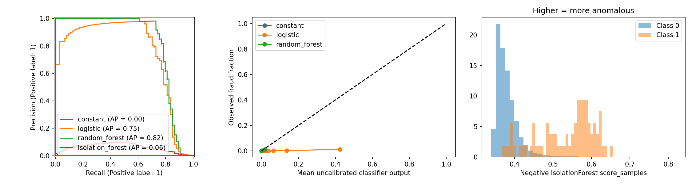
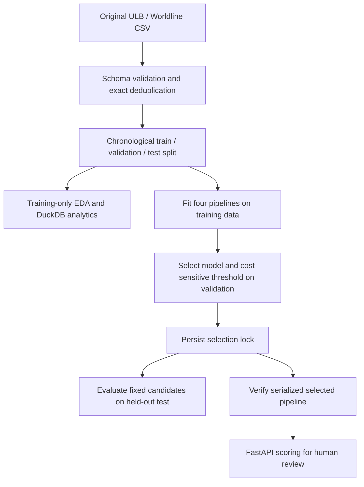

# Transaction Fraud Detection System

A reproducible portfolio prototype that ranks historical card transactions for **human review**. It compares supervised classification with anomaly detection, selects a cost-sensitive policy on validation, and serves the fitted pipeline through FastAPI. It does not authorize fraud determinations or automatically deny transactions.

**Status:** published and locally tested with the original ULB/Worldline dataset. [GitHub Actions](https://github.com/Duvi-M/transaction-fraud-detection-system/actions/workflows/ci.yml) reports remote CI status; Docker runtime remains unverified. See [release verification](RELEASE_REPORT.md) for the publication checks and the [Russian CV snippet](docs/cv_entry_ru.tex) for a concise project entry.

## Measured result

Original [Kaggle ULB/Worldline dataset](https://www.kaggle.com/datasets/mlg-ulb/creditcardfraud): 284,807 rows and 492 fraud labels. After removing 1,081 exact duplicate rows: 283,726 rows and 473 fraud labels. Chronological partitions have 342 / 57 / 74 fraud labels in train / validation / test. The test contains 56,746 transactions.

| Model | Validation cost | Test AP | Test precision | Test recall | Test alerts | Precision@100 | Recall@100 |
|---|---:|---:|---:|---:|---:|---:|---:|
| Constant prior | 5700 | 0.0013 | 0.0000 | 0.0000 | 0 | 0.00 | 0.0000 |
| Logistic regression | **1087** | 0.7475 | 0.2218 | 0.8514 | 284 | 0.58 | 0.7838 |
| Random forest | 1174 | **0.8166** | 0.4586 | 0.8243 | 133 | 0.60 | 0.8108 |
| Isolation forest | 3789 | 0.0605 | 0.0957 | 0.4189 | 324 | 0.02 | 0.0270 |

The locked policy selects **logistic regression** because it minimizes validation cost under a 1% validation alert cap. Assumed costs are FP=1 and FN=100 arbitrary units. Its threshold is 0.8907583217076319; test outcomes are **63 TP, 221 FP, 11 FN, 56,451 TN**, with 0.5005% of test transactions flagged. At a separate fixed top-100 budget it captures 58 of 74 fraud labels. Random forest has the highest measured test AP, but the test comparison is not used to switch the deployment model. AP is sklearn Average Precision, not trapezoidal PR area.

All scores are **uncalibrated**. Logistic regression's test Brier score is 0.02384 versus 0.00130 for the constant prior: good ranking does not establish useful probability calibration. See [full numeric results](reports/real/results.json), [selection lock](reports/real/selection_lock.json), [methodology](docs/methodology.md), and [comparison chart](reports/real/test_comparisons.png). Synthetic results are generated locally under `reports/synthetic/` and are engineering fixtures only.



## Reproduce locally

Use Python **3.12** and `uv`. Run from this directory:

```sh
make install                 # uv sync --frozen --extra dev
make acquire                 # public Kaggle download + SHA-256 verification
make lint
make test
make train                   # creates reports/reproduction and artifacts/real
.venv/bin/python scripts/smoke_api.py
make serve                   # http://127.0.0.1:8000/docs
```

The repository includes aggregate historical results in `reports/real/`, but no dataset or model. `make train` preserves those results and creates a fresh experiment in `reports/reproduction/`. It refuses to overwrite an existing result; for additional disclosed reproductions, choose new directories:

```sh
.venv/bin/fraud train --csv data/raw/creditcard.csv --kind real \
  --output reports/reproduction-2 --artifacts artifacts/reproduction-2
```

Without `uv`, create a Python 3.12 venv and use `python -m pip install -r requirements.lock`, then `python -m pip install --no-deps -e .`. Do not use an unpinned install to reproduce the reported environment. The lockfiles record exact dependencies; [release checks](reports/release_checks.json) record the tested environment. Raw data, environment caches and model artifacts are excluded from Git.

`make eda` produces the full raw audit, SQL CSV summaries and charts in `reports/eda/`. For a new experiment, preserve the held-out protocol: the training command automatically runs training-only EDA before selection and raw EDA after the lock. `make fixture` creates clearly labeled synthetic data and runs an independent fixture experiment; this never replaces real-data results. Both training commands refuse to overwrite an existing results directory.

## Architecture and contents




`src/fraud_detection/data/` implements validation and lineage; `modeling/` holds candidate pipelines and the experiment; `decisions/` holds cost, threshold and ranking rules; `evaluation/` writes metrics/plots; `api/` serves a trusted serialized model. `sql/analytics.sql` uses only real dataset columns. [Review guide](REVIEW_GUIDE.md) gives an ordered walkthrough; [interview preparation](docs/interview_preparation.md) explains the choices.

## API

- `GET /health`: readiness, or 503 if a verified model cannot load.
- `GET /model/info`: features, locked threshold, dataset provenance, configuration and versions.
- `POST /score`: one object with `Time`, `Amount`, and `V1`–`V28` as finite numbers. `Time` and `Amount` must be nonnegative. `Class`, strings and unknown fields are rejected with 422.
- `POST /score/batch`: `{"transactions": [<record>, ...]}`, 1–1,000 records, input order preserved.

To create and score a complete example from the downloaded dataset:

```sh
.venv/bin/python -c 'import pandas as pd; print(pd.read_csv("data/raw/creditcard.csv", nrows=1).drop(columns="Class").iloc[0].to_json())' > reports/example_request.json
curl -H 'Content-Type: application/json' --data-binary @reports/example_request.json http://127.0.0.1:8000/score
```

Response fields: `score`, `review_recommended`, `score_type`, `model`, `dataset_kind`. Scores can differ by floating-point roundoff between single and batch matrix operations; tests use tight tolerances and compare decisions exactly. Set `FRAUD_ARTIFACT` to select another trusted artifact. This variable is read from the process environment; `.env.example` is a reference, not automatically loaded. Never load untrusted joblib files.

## Docker and CI

Docker daemon was unavailable during implementation; these commands are **unverified** here:

```sh
docker build -t transaction-fraud .
docker run --rm -p 127.0.0.1:8000:8000 \
  -v "$PWD/artifacts/real:/app/artifacts:ro" transaction-fraud
```

The image runs as a non-root user and needs no dataset or credentials at runtime. A model is mounted read-only. The GitHub Actions workflow installs the lock, lints, formats and runs fixture-backed tests without acquiring Kaggle data. The workflow runs on Ubuntu 24.04 with Python 3.12.12; inspect [GitHub Actions](https://github.com/Duvi-M/transaction-fraud-detection-system/actions/workflows/ci.yml) for each commit's actual outcome.

## Limits

Two historical days, anonymized PCA, unknown upstream preprocessing and label delays, no entity IDs, only 74 test fraud labels, and no confidence intervals limit conclusions. A validation alert cap does not guarantee a future cap. Cost sensitivity represents assumptions, not bank savings. This prototype does not establish production latency, durability, fairness, drift management or investigator outcomes. Read [dataset provenance](docs/dataset.md) and [implementation report](IMPLEMENTATION_REPORT.md) before describing results on a CV.

## Future improvements

Evaluate longer out-of-time windows with delayed labels and temporal uncertainty estimates; assess probability calibration on separate calibration data; enforce review capacity through a queue; and add authentication, drift monitoring and load tests before considering operational use. These are future work, not measured capabilities.

## Published files and data handling

Only code, lockfiles, documentation, aggregate results and selected plots are tracked. Raw CSV/ZIP files, individual error records, row lineage, example transaction requests, local logs, caches and trained artifacts remain local. Download the source with `make acquire`; see [dataset terms and attribution](docs/dataset.md).
