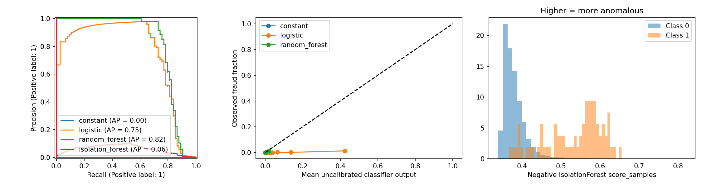
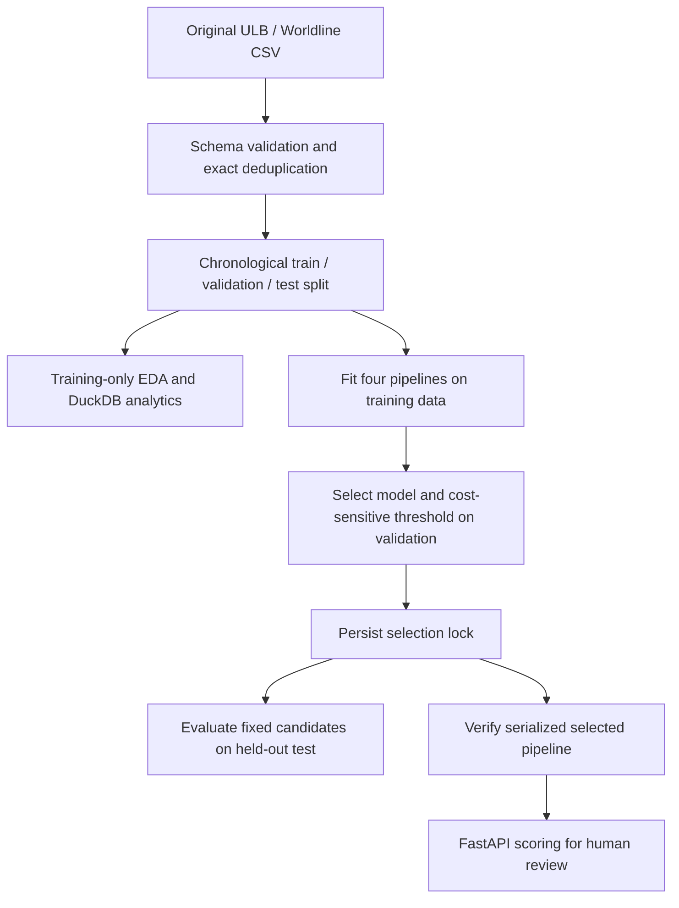

[English](README.md) | [Русский](README_RU.md)

# Система выявления мошеннических транзакций

Воспроизводимый прототип для портфолио, который ранжирует исторические карточные транзакции для **проверки специалистом**. В проекте сравниваются классификация с учителем и обнаружение аномалий, на валидационной выборке выбирается правило принятия решений с учётом стоимости ошибок, а обученный pipeline доступен через FastAPI. Прототип не выносит окончательных решений о мошенничестве и не отклоняет транзакции автоматически.

**Статус:** проект опубликован и протестирован локально на исходном датасете ULB/Worldline. Фактический статус CI доступен в [GitHub Actions](https://github.com/Duvi-M/transaction-fraud-detection-system/actions/workflows/ci.yml); запуск в Docker пока не проверен. Проверки перед публикацией описаны в [отчёте о проверке релиза](RELEASE_REPORT.md), а краткое описание проекта для резюме приведено в [фрагменте резюме на русском языке](docs/cv_entry_ru.tex).

## Результаты эксперимента

Исходный [датасет Kaggle ULB/Worldline](https://www.kaggle.com/datasets/mlg-ulb/creditcardfraud) содержит 284,807 строк и 492 транзакции с меткой мошенничества. После удаления 1,081 полностью дублирующейся строки остаются 283,726 строк и 473 транзакции с меткой мошенничества. При хронологическом разбиении число таких меток составляет 342 / 57 / 74 в train / validation / test соответственно. Тестовая выборка содержит 56,746 транзакций.

| Модель | Стоимость ошибок на validation | AP на test | Precision на test | Recall на test | Число сигналов на test | Precision@100 | Recall@100 |
|---|---:|---:|---:|---:|---:|---:|---:|
| Constant prior | 5700 | 0.0013 | 0.0000 | 0.0000 | 0 | 0.00 | 0.0000 |
| Logistic Regression | **1087** | 0.7475 | 0.2218 | 0.8514 | 284 | 0.58 | 0.7838 |
| Random Forest | 1174 | **0.8166** | 0.4586 | 0.8243 | 133 | 0.60 | 0.8108 |
| Isolation Forest | 3789 | 0.0605 | 0.0957 | 0.4189 | 324 | 0.02 | 0.0270 |

Зафиксированное правило выбора определяет **Logistic Regression** как итоговую модель: она минимизирует стоимость ошибок на validation при ограничении доли сигналов на этой выборке в 1%. Принятые стоимости ошибок — FP=1 и FN=100 условных единиц. Порог модели равен 0.8907583217076319; результаты на test — **63 TP, 221 FP, 11 FN, 56,451 TN**, при этом на проверку направляется 0.5005% тестовых транзакций. При отдельном фиксированном бюджете top-100 модель выявляет 58 из 74 транзакций с меткой мошенничества. У Random Forest наибольшая измеренная AP на test, однако сравнение на тестовой выборке не используется для замены модели, выбранной для обслуживания через API. AP — это Average Precision из sklearn, а не площадь под PR-кривой, рассчитанная методом трапеций.

Все оценки **некалиброванные**. Brier score модели Logistic Regression на test составляет 0.02384 против 0.00130 у Constant prior: хорошее ранжирование не означает, что оценки пригодны в качестве калиброванных вероятностей. См. [полные численные результаты](reports/real/results.json), [зафиксированный выбор модели и порогов](reports/real/selection_lock.json), [методологию](docs/methodology.md) и [сравнительный график](reports/real/test_comparisons.png). Результаты на синтетических данных генерируются локально в `reports/synthetic/` и служат только для инженерных проверок.



## Локальное воспроизведение

Используйте Python **3.12** и `uv`. Выполняйте команды из текущего каталога:

```sh
make install                 # uv sync --frozen --extra dev
make acquire                 # public Kaggle download + SHA-256 verification
make lint
make test
make train                   # creates reports/reproduction and artifacts/real
.venv/bin/python scripts/smoke_api.py
make serve                   # http://127.0.0.1:8000/docs
```

Репозиторий содержит агрегированные результаты ранее выполненного эксперимента в `reports/real/`, но не содержит датасет или модель. Команда `make train` сохраняет эти результаты и создаёт новый эксперимент в `reports/reproduction/`. Перезапись существующих результатов запрещена; для дополнительных воспроизведений с отдельно сохранёнными результатами укажите новые каталоги:

```sh
.venv/bin/fraud train --csv data/raw/creditcard.csv --kind real \
  --output reports/reproduction-2 --artifacts artifacts/reproduction-2
```

Если `uv` недоступен, создайте venv с Python 3.12 и выполните `python -m pip install -r requirements.lock`, затем `python -m pip install --no-deps -e .`. Для воспроизведения описанного окружения не устанавливайте зависимости без фиксации версий. Lock-файлы содержат точные версии зависимостей; сведения о протестированном окружении приведены в [результатах проверок релиза](reports/release_checks.json). Исходные данные, кеши окружения и артефакты моделей исключены из Git.

Команда `make eda` выполняет полный аудит исходных данных и сохраняет сводки SQL в формате CSV и графики в `reports/eda/`. В новом эксперименте соблюдайте протокол работы с отложенной выборкой: команда обучения автоматически выполняет EDA только на обучающих данных до выбора модели, а EDA исходных данных — после фиксации выбора. Команда `make fixture` создаёт явно обозначенные синтетические данные и запускает независимый эксперимент для инженерных проверок; он никогда не заменяет результаты на реальных данных. Обе команды обучения отказываются перезаписывать существующий каталог результатов.

## Архитектура и содержимое



`src/fraud_detection/data/` реализует валидацию и отслеживание происхождения данных; `modeling/` содержит pipeline моделей-кандидатов и код эксперимента; `decisions/` — правила расчёта стоимости ошибок, выбора порога и ранжирования; `evaluation/` сохраняет метрики и графики; `api/` предоставляет доступ к доверенной сериализованной модели. `sql/analytics.sql` использует только столбцы, присутствующие в исходном датасете. [Руководство по изучению проекта](REVIEW_GUIDE.md) предлагает последовательный обзор, а [материал для подготовки к собеседованию](docs/interview_preparation.md) объясняет принятые решения.

## API

- `GET /health`: готовность сервиса или 503, если проверенную модель не удалось загрузить.
- `GET /model/info`: признаки, зафиксированный порог, происхождение датасета, конфигурация и версии.
- `POST /score`: один объект с полями `Time`, `Amount` и `V1`–`V28`, содержащими конечные числа. Значения `Time` и `Amount` должны быть неотрицательными. Поле `Class`, строки и неизвестные поля отклоняются с кодом 422.
- `POST /score/batch`: `{"transactions": [<record>, ...]}`, 1–1,000 записей; порядок входных записей сохраняется.

Чтобы сформировать полный пример из загруженного датасета и получить оценку:

```sh
.venv/bin/python -c 'import pandas as pd; print(pd.read_csv("data/raw/creditcard.csv", nrows=1).drop(columns="Class").iloc[0].to_json())' > reports/example_request.json
curl -H 'Content-Type: application/json' --data-binary @reports/example_request.json http://127.0.0.1:8000/score
```

Поля ответа: `score`, `review_recommended`, `score_type`, `model`, `dataset_kind`. Оценки при обработке одной записи и пакета могут различаться из-за округления чисел с плавающей точкой в матричных операциях; тесты используют строгие допуски для оценок и проверяют точное совпадение решений. Чтобы выбрать другой доверенный артефакт, задайте `FRAUD_ARTIFACT`. Эта переменная считывается из окружения процесса; `.env.example` служит справочным примером и не загружается автоматически. Никогда не загружайте недоверенные файлы joblib.

## Docker и CI

Во время разработки Docker daemon был недоступен; приведённые команды здесь **не проверены**:

```sh
docker build -t transaction-fraud .
docker run --rm -p 127.0.0.1:8000:8000 \
  -v "$PWD/artifacts/real:/app/artifacts:ro" transaction-fraud
```

Образ запускается от пользователя без прав root и не требует датасета или учётных данных во время работы. Модель монтируется в режиме только для чтения. Workflow GitHub Actions устанавливает зависимости из lock-файла, выполняет проверки линтером и форматтером и запускает тесты на тестовых данных без загрузки данных Kaggle. Workflow работает на Ubuntu 24.04 с Python 3.12.12; фактический результат для каждого коммита смотрите в [GitHub Actions](https://github.com/Duvi-M/transaction-fraud-detection-system/actions/workflows/ci.yml).

## Ограничения

Выводы ограничены двумя историческими днями наблюдений, анонимизированными признаками PCA, неизвестной предобработкой у источника и задержками появления меток, отсутствием идентификаторов сущностей, всего 74 метками мошенничества на test и отсутствием доверительных интервалов. Ограничение доли сигналов на validation не гарантирует соблюдения этого ограничения в будущем. Учёт стоимости ошибок отражает допущения, а не экономию банка. Прототип не подтверждает производственные характеристики задержки и надёжности, справедливость решений, управление дрейфом или результаты работы специалистов по расследованию. Перед описанием результатов в резюме изучите [происхождение датасета](docs/dataset.md) и [отчёт о реализации](IMPLEMENTATION_REPORT.md).

## Дальнейшие улучшения

Оценить качество на более длительных будущих временных интервалах с учётом задержек меток и оценками неопределённости во времени; проверить калибровку вероятностей на отдельной калибровочной выборке; обеспечить соблюдение пропускной способности ручной проверки с помощью очереди; добавить аутентификацию, мониторинг дрейфа и нагрузочное тестирование перед рассмотрением возможности эксплуатационного использования. Это планы дальнейшей работы, а не измеренные возможности прототипа.

## Опубликованные файлы и работа с данными

В Git отслеживаются только код, lock-файлы, документация, агрегированные результаты и отдельные графики. Исходные CSV/ZIP-файлы, записи об отдельных ошибках, сведения о происхождении отдельных строк, примеры запросов с транзакциями, локальные логи, кеши и обученные артефакты остаются локально. Для загрузки исходных данных используйте `make acquire`; см. [условия использования датасета и указание источника](docs/dataset.md).
